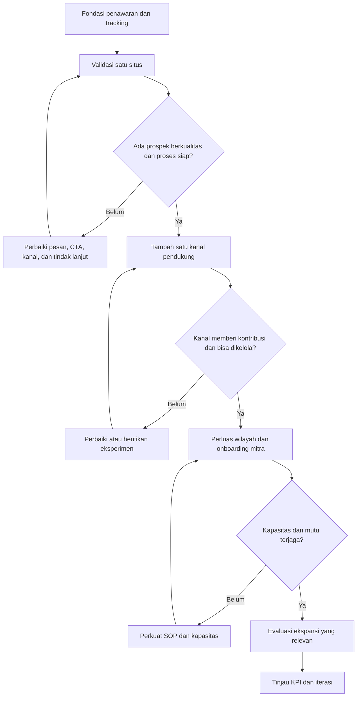

# Roadmap Kemitraan SLF/PBG

## 1. Tujuan dan prinsip pelaksanaan

Roadmap ini bertujuan membangun saluran akuisisi mitra yang terukur untuk layanan SLF/PBG, mulai dari referral hingga pengembangan Perwakilan Daerah dan Cabang Resmi. Roadmap juga mendukung strategi **dominasi SERP**: memperbesar peluang agar beberapa entitas bisnis yang benar-benar berbeda—termasuk sister company dan kanal afiliasi yang sah—muncul untuk kumpulan kueri strategis yang relevan. Keberhasilan tidak diukur dari jumlah domain semata, tetapi dari cakupan kueri, posisi yang benar-benar diperoleh, klik non-merek, prospek berkualitas, dan ketahanan jangka panjang.

Prinsip utama:

- **Validasi sebelum ekspansi.** Buktikan bahwa penawaran kemitraan menghasilkan prospek berkualitas sebelum menambah situs, merek, atau platform.
- **Satu sumber kebenaran.** Informasi perusahaan, layanan, kontak, persyaratan, dan klaim kompetensi harus konsisten di seluruh kanal.
- **Pisahkan trafik dari hasil bisnis.** Tayangan dan kunjungan adalah indikator awal; prospek berkualitas, pertemuan, perjanjian, dan mitra aktif adalah hasil yang lebih penting.
- **Utamakan kepercayaan.** Jelaskan ruang lingkup, pembagian tanggung jawab, dukungan, biaya bila ada, dan batas kewenangan setiap jenis kemitraan.
- **Bangun portofolio situs dengan alasan bisnis nyata.** Sister company dapat menjadi kanal akuisisi terpisah jika identitas, penawaran, bukti, audiens atau cara melayaninya memang berbeda dan dijelaskan secara transparan. 
- **Tidak menjanjikan hasil yang belum terbukti.** Target di bawah adalah hipotesis kerja awal, bukan proyeksi yang sudah tervalidasi.

## 2. Empat skema kemitraan

| Skema | Peran utama | Keterlibatan teknis | Tingkat kesiapan |
|---|---|---|---|
| Referral | Memperkenalkan calon klien yang relevan | Tidak melakukan kajian teknis | Paling mudah untuk diuji |
| Mitra Kolaboratif | Bekerja sama berdasarkan kebutuhan proyek | Sesuai kompetensi dan kesepakatan; pekerjaan teknis hanya oleh pihak yang memenuhi persyaratan | Setelah alur kerja dan pembagian tanggung jawab jelas |
| Perwakilan Daerah | Mengembangkan pasar dan koordinasi lokal | Tidak otomatis berwenang melakukan kajian teknis atau menerbitkan dokumen teknis | Memerlukan proses seleksi, wilayah, dan target yang jelas |
| Cabang Resmi | Menjalankan operasi wilayah dengan standar perusahaan | Sesuai struktur, kompetensi, kewenangan, dan sistem pengawasan yang ditetapkan | Tahap paling matang; perlu tata kelola dan kontrol mutu |

Setiap skema perlu memiliki halaman penjelasan atau bagian khusus yang menjawab: siapa yang cocok, tugas, batas kewenangan, dukungan perusahaan, alur calon klien, model imbalan bila berlaku, evaluasi kinerja, dan cara mendaftar. Hindari menjanjikan pendapatan atau wilayah eksklusif sebelum ketentuannya disepakati secara tertulis.

## 3. Strategi kanal: mulai dari yang dapat dikelola

### Kanal inti

1. **Situs utama** sebagai sumber informasi resmi, halaman program kemitraan, formulir minat, dan pusat konversi.
2. **Google Business Profile** hanya untuk lokasi dan operasi yang benar-benar memenuhi pedoman Google. Jangan membuat listing fiktif atau banyak listing untuk alamat yang tidak memenuhi syarat.
3. **LinkedIn** untuk kredibilitas B2B, profil profesional yang nyata, jejaring, dan publikasi studi kasus atau wawasan.
4. **WhatsApp bisnis / kontak resmi** untuk menindaklanjuti prospek dengan pencatatan sumber dan status.
5. **Analitik dan CRM sederhana** untuk mencatat asal prospek, kebutuhan, wilayah, skema yang diminati, tindak lanjut, dan hasil.

### Kanal pendukung, setelah kanal inti berjalan

- **YouTube:** video edukasi proses, penjelasan dokumen, dan studi kasus yang tidak membuka data klien tanpa izin.
- **Medium atau Kompasiana:** artikel adaptasi yang memberi nilai tambahan dan merujuk ke sumber utama secara wajar. Jangan mengandalkan canonical yang tidak tersedia atau tidak dapat dikendalikan di platform tersebut.
- **Instagram/Facebook:** bukti aktivitas, edukasi visual, dan jangkauan; bukan pengganti halaman informasi lengkap.
- **Link-in-bio / microsite:** opsional jika menyelesaikan kebutuhan nyata. Jangan menambahkannya hanya untuk mengejar backlink; tautan langsung ke halaman situs utama sering sudah cukup.
- **Direktori industri/asosiasi:** dipilih berdasarkan reputasi, relevansi, dan kelayakan listing.

Profil sekoci bukan jaminan peningkatan peringkat atau backlink yang bernilai. Buat profil hanya jika ada pemilik kanal, tujuan, informasi yang benar, dan rencana pemeliharaan.

### Tiga jalur strategi ekspansi

Ketiga jalur ini adalah **pilihan strategi dengan skala berbeda**, bukan tahapan wajib yang menggantikan satu sama lain. Tahapan operasional setelah bagian ini menjadi gerbang kesiapan yang dapat diterapkan pada jalur mana pun.

| Jalur | Arsitektur | Tujuan utama | Indikator awal untuk diuji | Kapan dipilih |
|---|---|---|---|---|
| **Jalur Lambat — satu situs** | Fokus pada situs utama; optimalkan SEO on-site, off-site, konten, konversi, dan kanal inti | Memaksimalkan kekuatan satu domain sebelum menambah kompleksitas | Hipotesis awal: sekitar 1.000 tayangan organik/bulan; ukur prospek dan mitra dari baseline aktual | Sumber daya terbatas, situs utama masih punya ruang pertumbuhan, atau proses konversi belum stabil |
| **Jalur Menengah — 3–4 situs** | Situs utama ditambah 2–3 situs sister company/entitas bisnis yang nyata dan mempunyai positioning masing-masing | Memperluas cakupan kueri dan menguji apakah beberapa domain dapat muncul bersamaan pada SERP strategis | Hipotesis awal: sekitar 5.000 tayangan organik/bulan untuk portofolio; ukur jumlah kueri dengan lebih dari satu domain tampil dan kontribusi prospek inkremental | Ada entitas yang sah, proposisi nilai berbeda, kapasitas konten/operasional, serta bukti bahwa ekspansi domain layak |
| **Jalur Ekstensi — portofolio situs + profil pendukung** | Jalur Menengah ditambah profil dan kanal pendukung yang relevan, misalnya LinkedIn, YouTube, media artikel, direktori industri, serta Google Business Profile hanya untuk lokasi yang memenuhi syarat | Memperluas titik penemuan merek, reputasi, rujukan, dan peluang kehadiran di SERP di luar situs mandiri | Hipotesis awal: sekitar 10.000 tayangan organik/bulan untuk portofolio; ukur kontribusi tiap kanal, bukan jumlah profil | Portofolio situs sudah terkelola dan ada sumber daya untuk menjaga kualitas serta konsistensi seluruh kanal |

**Catatan target:** angka tayangan di atas merupakan hipotesis kerja awal, bukan benchmark industri atau jaminan hasil. Target jumlah mitra—misalnya 3, 15, atau 30—jangan dianggap setara dengan target trafik dan jangan dijadikan komitmen sebelum baseline prospek, rasio kualifikasi, kapasitas tindak lanjut, serta konversi tersedia. Tetapkan sasaran kemitraan setelah data awal terkumpul.

#### Cara memilih jalur

- Tidak wajib menjalankan Jalur Lambat sebelum Jalur Menengah jika bukti kesiapan sudah tersedia; namun keputusan harus didukung data dan kapasitas.
- Jalur Menengah berarti mengembangkan **entitas dan situs yang memang berbeda**, bukan membuat 3–4 salinan situs utama. Setiap situs harus lulus kriteria kelayakan sister company pada bagian berikut.
- Jalur Ekstensi menambah kanal distribusi dan reputasi, bukan sekadar membuat profil kosong demi backlink.
- Ketiga jalur dinilai dengan tujuan yang sama: cakupan SERP yang relevan, klik organik tambahan, prospek berkualitas, konversi, biaya pengelolaan, dan risiko.
- Jalur dapat dihentikan, digabung, atau diturunkan skalanya jika tidak menghasilkan kontribusi tambahan atau membebani operasi.

## 4. Tahapan operasional dan gerbang keputusan lintas jalur

### Tahap 0 — Fondasi dan kesiapan penawaran (minggu 1–2)

**Pekerjaan**
- Tetapkan satu halaman utama program kemitraan dan halaman untuk empat skema.
- Pastikan setiap halaman menjelaskan manfaat, syarat, batas peran, proses seleksi, FAQ, dan CTA yang relevan.
- Siapkan formulir dengan data minimum: nama, organisasi, wilayah, skema minat, pengalaman relevan, kontak, dan persetujuan untuk dihubungi.
- Buat template tindak lanjut, daftar pertanyaan kualifikasi, dan dokumen ringkas program.
- Pasang pengukuran untuk kunjungan, klik CTA, pengiriman formulir, klik WhatsApp, dan sumber kampanye.
- Tetapkan penanggung jawab dan waktu respons prospek.

**Gerbang lanjut:** formulir dan kontak teruji, setiap prospek dapat dicatat, dan tim mampu menindaklanjuti sesuai SLA internal. Perbaiki hambatan teknis sebelum meningkatkan promosi.

### Tahap 1 — Validasi satu situs (bulan 1–2)

**Fokus:** situs utama dan penawaran referral sebagai pintu masuk yang relatif sederhana.

**Pekerjaan**
- Optimasi SEO teknis dan on-page, tautan internal, halaman skema, serta artikel yang menjawab pertanyaan calon mitra.
- Buat konten berbasis kebutuhan nyata: siapa yang cocok menjadi mitra, alur kerja, tanggung jawab, dokumen awal, dan contoh kolaborasi yang dapat dipublikasikan.
- Lakukan outreach langsung yang relevan kepada jaringan profesional, asosiasi, pelaku properti, konsultan, dan pelaku usaha daerah; hindari spam massal.
- Catat pertanyaan, keberatan, dan alasan prospek tidak melanjutkan untuk memperbaiki penawaran.
- Evaluasi data setiap minggu dan lakukan tinjauan bulanan.

**Gerbang lanjut:** terdapat bukti prospek berkualitas dan pola kebutuhan yang berulang, proses tindak lanjut berjalan, dan tim dapat menjelaskan kanal mana yang menghasilkan percakapan bermutu. Jika belum, lanjutkan eksperimen pada penawaran dan kanal; jangan buru-buru menambah situs.

### Tahap 2 — Penguatan konversi dan kanal pendukung (bulan 3–4)

**Pekerjaan**
- Perbaiki halaman berdasarkan pertanyaan dan keberatan prospek nyata.
- Aktifkan LinkedIn secara konsisten; tambah satu kanal pendukung saja pada satu waktu, misalnya YouTube atau platform artikel.
- Publikasikan studi kasus dengan izin dan tanpa klaim hasil yang tidak dapat dibuktikan.
- Uji variasi CTA, formulir singkat, dan penjelasan skema; ubah satu variabel utama setiap eksperimen.
- Mulai uji terbatas untuk Mitra Kolaboratif atau Perwakilan Daerah jika prosedur, seleksi, dan pembagian tanggung jawab sudah siap.

**Gerbang lanjut:** kanal inti tetap terkelola, prospek dapat ditindaklanjuti, dan kanal pendukung menunjukkan kontribusi yang bisa diamati—bukan sekadar jumlah profil atau follower.

### Tahap 3 — Replikasi portofolio dan uji dominasi SERP (bulan 5–6)

**Pekerjaan**
- Perluas wilayah outreach berdasarkan data permintaan dan kapasitas operasional.
- Susun paket onboarding mitra, SOP koordinasi, pelaporan, standar komunikasi, mekanisme eskalasi, dan evaluasi berkala.
- Pilih satu sister company atau entitas bisnis yang nyata sebagai pilot berikutnya. Sebelum membangun situs, dokumentasikan proposisi nilai, audiens, layanan, bukti kompetensi, konten inti, kepemilikan, kontak, dan hubungan dengan perusahaan utama.
- Tentukan kelompok kueri untuk tiap situs berdasarkan maksud pencarian dan penawaran yang benar-benar dapat dilayani; hindari membuat beberapa situs yang hanya menargetkan variasi kata kunci sama dengan isi dan tujuan identik.
- Ukur apakah portofolio memperluas jangkauan organik secara inkremental: kueri baru, tayangan non-merek, klik, posisi, prospek berkualitas, dan kontribusi masing-masing situs. Catat juga tumpang tindih kueri dan kanibalisasi.
- Pertimbangkan Cabang Resmi hanya setelah model kemitraan, kontrol mutu, tanggung jawab, kebutuhan sumber daya, dan tata kelola terbukti berjalan.

**Gerbang lanjut:** replikasi hanya diteruskan jika entitas kedua memiliki manfaat yang jelas bagi pengguna, tidak sekadar menduplikasi situs utama, mampu dikelola, dan memberi kontribusi tambahan yang terukur. Hasil SERP dinilai sebagai eksperimen—bukan jaminan semua situs akan tampil bersamaan di halaman 1–2.

## 5. Strategi sister company dan dominasi SERP

### Tujuan strategi

Tujuannya adalah meningkatkan **pangsa kehadiran di hasil pencarian** untuk kueri strategis SLF/PBG, sehingga pengguna dapat menemukan lebih dari satu bisnis dalam ekosistem perusahaan pada hasil yang sama ketika masing-masing hasil memang relevan. Portofolio ini dapat mencakup situs perusahaan utama, situs sister company, dan profil resmi afiliasi/kanal pendukung.

Asumsinya bukan bahwa satu perusahaan harus terus menambah halaman di satu domain. Sebaliknya, entitas bisnis yang berbeda dapat mengembangkan reputasi, penawaran, bukti, dan cakupan audiens masing-masing. Keberhasilan SEO on-site dan off-site pada situs yang sudah ada adalah modal awal untuk menguji strategi portofolio, tetapi **tidak membuktikan bahwa beberapa situs akan otomatis menempati halaman 1–2 secara bersamaan**.

### Kriteria kelayakan sister company

Sebelum investasi pada domain dan situs baru, buat dokumen singkat untuk menjawab:

- **Entitas nyata:** badan usaha, merek, atau unit bisnis memang ada dan memiliki identitas serta penanggung jawab yang dapat diverifikasi.
- **Proposisi nilai berbeda:** ada perbedaan nyata pada layanan, spesialisasi, segmen pelanggan, wilayah operasi yang benar-benar dilayani, metode layanan, atau bukti pengalaman—bukan hanya pergantian nama.
- **Kegunaan mandiri:** situs memberi informasi dan jalur layanan yang lengkap bagi pengunjung tanpa mengharuskan mereka dialihkan ke situs utama untuk mendapatkan nilai yang dijanjikan.
- **Konten orisinal:** halaman inti, studi kasus, profil tim/kompetensi, proses, FAQ, dan materi pendukung dibuat berdasarkan fakta serta kebutuhan entitas tersebut. Konten boleh membahas topik sejenis, tetapi tidak sekadar salinan yang disamarkan.
- **Transparansi hubungan:** kepemilikan atau afiliasi dijelaskan secara wajar; identitas, alamat, kontak, dan klaim kompetensi tidak dibuat menyesatkan.
- **Kesiapan operasional:** ada kapasitas untuk pemeliharaan, keamanan, analitik, penanganan prospek, dan pembaruan konten.
- **Tujuan pencarian yang terpetakan:** setiap situs punya kelompok kueri dan maksud pencarian yang masuk akal untuk dilayani, sambil tetap mengakui bahwa sebagian kueri akan tumpang tindih.

Jika tidak ada alasan kuat yang memenuhi kriteria tersebut, lebih baik memperkuat halaman dan kelompok topik pada situs yang ada daripada membuat domain baru.

### Eksperimen bertahap

1. **Baseline:** dokumentasikan kueri prioritas, posisi, tayangan, klik, halaman yang mendapat impresi, dan prospek dari situs utama.
2. **Pilih satu pilot:** gunakan satu sister company yang memiliki perbedaan bisnis dan bukti yang nyata;
3. **Bangun kualitas sebelum skala:** pastikan identitas, penawaran, konten inti, bukti, kontak, tracking, dan proses layanan siap sebelum promosi SEO diperluas.
4. **Ukur kontribusi inkremental:** bandingkan total klik dan prospek portofolio dengan baseline situs utama, bukan hanya menghitung peringkat setiap domain secara terpisah.
5. **Evaluasi kanibalisasi:** catat apakah situs baru membuka kueri/audiens baru atau justru mengambil impresi dari situs utama tanpa menambah hasil bisnis.
6. **Putuskan berdasarkan bukti:** lanjutkan, revisi positioning, atau hentikan pilot sebelum menambah entitas berikutnya.

### KPI dominasi SERP

- Jumlah dan persentase kueri prioritas yang memiliki setidaknya satu listing portofolio pada halaman 1.
- Jumlah kueri yang memiliki listing relevan pada halaman 2.
- Jumlah kueri dengan dua atau lebih domain portofolio yang benar-benar tampil bersamaan.
- Pangsa tayangan dan klik organik portofolio pada kelompok kueri prioritas.
- Klik dan prospek berkualitas tambahan yang diperoleh setelah situs pilot diluncurkan.
- Tingkat tumpang tindih kueri dan indikasi kanibalisasi antar-situs.
- Biaya dan jam kerja per prospek berkualitas dari setiap entitas.

Gunakan Google Search Console untuk data per situs dan kueri, lalu satukan dalam dashboard portofolio dengan periode, negara, perangkat, dan definisi metrik yang konsisten. Catat hasil berdasarkan observasi data, bukan satu kali pengecekan SERP manual yang dapat berbeda menurut lokasi, waktu, dan konteks pengguna.

## 6. KPI dan cara mengukurnya

Gunakan funnel berikut sebagai dashboard utama:

1. **Jangkauan:** tayangan pencarian, jangkauan publikasi, dan kunjungan situs.
2. **Ketertarikan:** klik CTA, kunjungan halaman skema, dan interaksi kontak.
3. **Prospek:** formulir masuk atau percakapan yang dapat diidentifikasi.
4. **Prospek berkualitas:** calon mitra memenuhi kriteria minimum dan memiliki kebutuhan serta wilayah yang jelas.
5. **Konversi:** pertemuan, lolos seleksi, kesepakatan tertulis, onboarding, dan mitra aktif.
6. **Kualitas:** waktu respons, tingkat tidak lanjut, alasan penolakan, kepuasan, dan kontribusi mitra.

Catat definisi setiap metrik. Jangan menyamakan klik WhatsApp dengan prospek berkualitas, atau menyamakan mitra yang baru mendaftar dengan mitra aktif.

### Target awal untuk validasi

Angka berikut adalah **target eksperimen internal**, bukan benchmark industri atau jaminan hasil. Tetapkan baseline setelah data tersedia dan tinjau setiap bulan.

| Periode | Fokus hasil | Kriteria evaluasi |
|---|---|---|
| Bulan 1 | Pengukuran dan kesiapan konversi | Semua CTA penting terlacak; prospek dapat ditelusuri sumbernya |
| Bulan 2 | Validasi pesan dan sumber prospek | Ada data awal tentang pertanyaan, kualitas, dan alasan penolakan |
| Bulan 3–4 | Konsistensi prospek berkualitas | Ada kanal yang menghasilkan percakapan relevan secara berulang |
| Bulan 5–6 | Replikasi dan kesiapan operasional | Hasil kanal, kapasitas tim, dan proses onboarding mendukung ekspansi |

Tayangan bulanan seperti 1.000, 5.000, atau 10.000 dapat dipakai sebagai indikator SEO tambahan jika konteksnya jelas, tetapi jangan dijadikan janji pertumbuhan kemitraan. Target jumlah kemitraan baru sebaiknya ditetapkan setelah baseline konversi diketahui.

### Rumus evaluasi

- Rasio CTA = klik CTA ÷ kunjungan halaman terkait.
- Rasio prospek = jumlah prospek ÷ jumlah kunjungan atau interaksi yang relevan.
- Rasio kualifikasi = prospek berkualitas ÷ total prospek.
- Rasio konversi mitra = mitra yang menyepakati kerja sama ÷ prospek berkualitas.
- Biaya per prospek berkualitas = biaya kanal ÷ jumlah prospek berkualitas dari kanal tersebut.

Gunakan periode dan definisi yang konsisten saat membandingkan kanal.

## 7. Sistem tindak lanjut prospek

Setiap prospek perlu memiliki status yang jelas:

**Baru → Dihubungi → Terkualifikasi → Diskusi → Seleksi/Proposal → Disepakati → Onboarding → Aktif**

Status alternatif: **Tidak sesuai**, **Tidak merespons**, **Ditunda**, atau **Ditolak**, disertai alasan singkat.

Data minimum yang dicatat:
- tanggal masuk dan sumber;
- nama serta organisasi;
- wilayah dan skema minat;
- kebutuhan dan pengalaman yang relevan;
- status terakhir, pemilik tindak lanjut, dan tanggal tindakan berikutnya;
- alasan menang/kalah atau tidak melanjutkan.

Tetapkan SLA respons internal yang realistis, misalnya satu hari kerja, lalu ukur kepatuhannya. Simpan data secukupnya, batasi akses, dan gunakan sesuai persetujuan serta aturan privasi yang berlaku.

## 8. Ritme kerja

**Mingguan**
- Periksa prospek baru dan tindak lanjut yang tertunda.
- Periksa formulir, tautan, tracking, dan halaman dengan masalah.
- Catat pertanyaan calon mitra dan hambatan konversi.

**Bulanan**
- Bandingkan kanal berdasarkan prospek berkualitas dan konversi, bukan trafik saja.
- Tinjau konten yang membawa kunjungan relevan serta halaman yang gagal mengonversi.
- Putuskan satu sampai tiga perbaikan paling berdampak untuk bulan berikutnya.

**Akhir setiap tahap**
- Dokumentasikan hasil, biaya/waktu, risiko, dan pelajaran.
- Putuskan secara eksplisit: lanjut, perbaiki, atau hentikan eksperimen.
- Jangan melanjutkan ekspansi hanya karena jadwal roadmap telah tiba.

## 9. Risiko utama dan mitigasi

| Risiko | Mitigasi |
|---|---|
| Trafik naik tetapi tidak ada prospek | Perjelas audiens, CTA, penawaran, dan pengukuran funnel |
| Terlalu banyak kanal tidak terurus | Batasi kanal aktif dan tunjuk penanggung jawab |
| Banyak situs dengan konten serupa | Gunakan satu situs utama kecuali ada alasan bisnis yang sah dan berbeda |
| Prospek salah memahami kewenangan mitra | Jelaskan batas peran, kompetensi, dan tanggung jawab sejak awal |
| Mitra mendaftar tetapi tidak aktif | Onboarding, target realistis, pendampingan, dan evaluasi berkala |
| Klaim pemasaran tidak dapat dibuktikan | Gunakan bukti yang dapat diverifikasi dan persetujuan publikasi |
| Kapasitas tim tidak cukup untuk ekspansi | Jadikan kapasitas layanan dan mutu sebagai gerbang ekspansi |

## 10. Keputusan yang perlu ditetapkan pemilik program

Sebelum menjalankan roadmap, tetapkan:
- penanggung jawab program dan tindak lanjut prospek;
- wilayah prioritas berdasarkan kapasitas dan jaringan nyata;
- kriteria kualifikasi untuk masing-masing skema;
- dukungan, model imbalan, dan ketentuan kerja sama;
- target baseline dan batas waktu respons;
- kapasitas tim untuk onboarding serta kontrol mutu;
- anggaran waktu/biaya untuk kanal yang dipilih.

Keputusan tersebut sebaiknya terdokumentasi dan ditinjau setelah data awal terkumpul.

## 11. Visualisasi alur

---

Roadmap ini bersifat iteratif. Perbarui keputusan berdasarkan data aktual, kualitas calon mitra, kapasitas operasional, dan hasil evaluasi—bukan berdasarkan jumlah situs atau akun yang berhasil dibuat.
