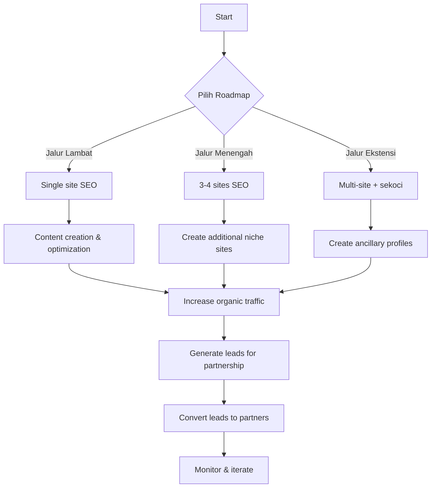

# Roadmap Kemitraan SLF/PBG

## Skema Kemitraan (empat)

1. **Referral** – memperkenalkan calon klien kepada perusahaan tanpa menangani kajian teknis.
2. **Mitra Kolaboratif** – kerja sama proyek per‑proyek, berbagi jaringan dan dukungan teknis.
3. **Perwakilan Daerah** – mengembangkan pasar dan koordinasi lokal, tidak melakukan kajian teknis.
4. **Cabang Resmi** – operasi wilayah lengkap dengan SOP, pengawasan mutu, dan penggunaan merek resmi.

## Rencana Roadmap

### 1️⃣ Jalur Lambat – 1 situs dengan SEO optimal
- Fokus pada situs utama **konsultan-slf.lan**.
- Optimasi on‑page SEO, konten blog, dan backlink berkualitas.
- Target: **≥ 1 000 tayangan/bulan** & **3 kemitraan** dalam 6 bulan.

### 2️⃣ Jalur Menengah – 3‑4 situs dengan SEO teroptimasi
- Tambah situs penuh (bukan sub-domain/situs mikro) dengan perusahaan/entitas berbeda, masing-masing dengan domain & brand sendiri.
- Setiap situs menargetkan kata kunci niche ("perwakilan daerah SLF", "mitra kolaboratif SLF", dll.).
- Target: **≥ 5 000 tayangan/bulan** & **15 kemitraan** dalam 6 bulan.

### 3️⃣ Jalur Ekstensi – Jalur 2 + profil sekoci
- Buat profil pendukung seperti **Google Business Profile**, **LinkedIn (halaman perusahaan + profil personal)**, **Medium/Kompasiana**, serta **1 link-in-bio (Beacons/Carrd)** sebagai hub, serta platform profil profesional (LinkedIn, Instagram).
- Gunakan profil sekoci untuk mengarahkan trafik ke situs utama dan menambah otoritas domain.
- Target: **≥ 10 000 tayangan/bulan** & **30 kemitraan** dalam 6 bulan.
- Opsi lengkap & rekomendasi: lihat `docs/PROFIL-SEKOCI.md`.

> *Catatan:* Target dapat disesuaikan selama diskusi, file ini akan terus diperbarui.
>
> **Asumsi:** Angka kemitraan (3, 8, 10) bersifat perkiraan karena belum ada data minat audiens terhadap program kemitraan.

## Visualisasi Flowchart

---

*Dokumen ini akan diperbarui seiring perkembangan strategi dan hasil analitik.*