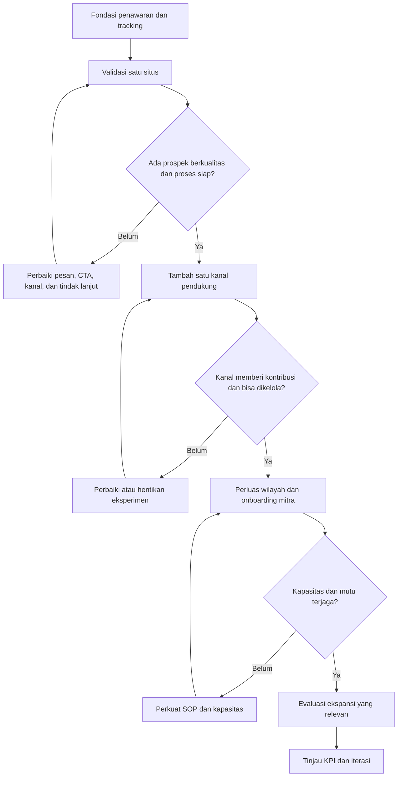

# Roadmap Kemitraan SLF/PBG

## 1. Tujuan dan prinsip pelaksanaan

Roadmap ini bertujuan membangun saluran akuisisi mitra yang terukur untuk layanan SLF/PBG, mulai dari referral hingga pengembangan Perwakilan Daerah dan Cabang Resmi.

Prinsip utama:

- **Validasi sebelum ekspansi.** Buktikan bahwa penawaran kemitraan menghasilkan prospek berkualitas sebelum menambah situs, merek, atau platform.
- **Satu sumber kebenaran.** Informasi perusahaan, layanan, kontak, persyaratan, dan klaim kompetensi harus konsisten di seluruh kanal.
- **Pisahkan trafik dari hasil bisnis.** Tayangan dan kunjungan adalah indikator awal; prospek berkualitas, pertemuan, perjanjian, dan mitra aktif adalah hasil yang lebih penting.
- **Utamakan kepercayaan.** Jelaskan ruang lingkup, pembagian tanggung jawab, dukungan, biaya bila ada, dan batas kewenangan setiap jenis kemitraan.
- **Jangan membuat situs hanya untuk memperbanyak domain.** Setiap situs tambahan harus punya alasan bisnis, audiens, konten orisinal, entitas yang jelas, serta kemampuan pengelolaan sendiri.
- **Tidak menjanjikan hasil yang belum terbukti.** Target di bawah adalah hipotesis kerja awal, bukan proyeksi yang sudah tervalidasi.

## 2. Empat skema kemitraan

| Skema | Peran utama | Keterlibatan teknis | Tingkat kesiapan |
|---|---|---|---|
| Referral | Memperkenalkan calon klien yang relevan | Tidak melakukan kajian teknis | Paling mudah untuk diuji |
| Mitra Kolaboratif | Bekerja sama berdasarkan kebutuhan proyek | Sesuai kompetensi dan kesepakatan; pekerjaan teknis hanya oleh pihak yang memenuhi persyaratan | Setelah alur kerja dan pembagian tanggung jawab jelas |
| Perwakilan Daerah | Mengembangkan pasar dan koordinasi lokal | Tidak otomatis berwenang melakukan kajian teknis atau menerbitkan dokumen teknis | Memerlukan proses seleksi, wilayah, dan target yang jelas |
| Cabang Resmi | Menjalankan operasi wilayah dengan standar perusahaan | Sesuai struktur, kompetensi, kewenangan, dan sistem pengawasan yang ditetapkan | Tahap paling matang; perlu tata kelola dan kontrol mutu |

Setiap skema perlu memiliki halaman penjelasan atau bagian khusus yang menjawab: siapa yang cocok, tugas, batas kewenangan, dukungan perusahaan, alur calon klien, model imbalan bila berlaku, evaluasi kinerja, dan cara mendaftar. Hindari menjanjikan pendapatan atau wilayah eksklusif sebelum ketentuannya disepakati secara tertulis.

## 3. Strategi kanal: mulai dari yang dapat dikelola

### Kanal inti

1. **Situs utama** sebagai sumber informasi resmi, halaman program kemitraan, formulir minat, dan pusat konversi.
2. **Google Business Profile** hanya untuk lokasi dan operasi yang benar-benar memenuhi pedoman Google. Jangan membuat listing fiktif atau banyak listing untuk alamat yang tidak memenuhi syarat.
3. **LinkedIn** untuk kredibilitas B2B, profil profesional yang nyata, jejaring, dan publikasi studi kasus atau wawasan.
4. **WhatsApp bisnis / kontak resmi** untuk menindaklanjuti prospek dengan pencatatan sumber dan status.
5. **Analitik dan CRM sederhana** untuk mencatat asal prospek, kebutuhan, wilayah, skema yang diminati, tindak lanjut, dan hasil.

### Kanal pendukung, setelah kanal inti berjalan

- **YouTube:** video edukasi proses, penjelasan dokumen, dan studi kasus yang tidak membuka data klien tanpa izin.
- **Medium atau Kompasiana:** artikel adaptasi yang memberi nilai tambahan dan merujuk ke sumber utama secara wajar. Jangan mengandalkan canonical yang tidak tersedia atau tidak dapat dikendalikan di platform tersebut.
- **Instagram/Facebook:** bukti aktivitas, edukasi visual, dan jangkauan; bukan pengganti halaman informasi lengkap.
- **Link-in-bio / microsite:** opsional jika menyelesaikan kebutuhan nyata. Jangan menambahkannya hanya untuk mengejar backlink; tautan langsung ke halaman situs utama sering sudah cukup.
- **Direktori industri/asosiasi:** dipilih berdasarkan reputasi, relevansi, dan kelayakan listing.

Profil sekoci bukan jaminan peningkatan peringkat atau backlink yang bernilai. Buat profil hanya jika ada pemilik kanal, tujuan, informasi yang benar, dan rencana pemeliharaan.

## 4. Tahapan roadmap dan gerbang keputusan

### Tahap 0 — Fondasi dan kesiapan penawaran (minggu 1–2)

**Pekerjaan**
- Tetapkan satu halaman utama program kemitraan dan halaman untuk empat skema.
- Pastikan setiap halaman menjelaskan manfaat, syarat, batas peran, proses seleksi, FAQ, dan CTA yang relevan.
- Siapkan formulir dengan data minimum: nama, organisasi, wilayah, skema minat, pengalaman relevan, kontak, dan persetujuan untuk dihubungi.
- Buat template tindak lanjut, daftar pertanyaan kualifikasi, dan dokumen ringkas program.
- Pasang pengukuran untuk kunjungan, klik CTA, pengiriman formulir, klik WhatsApp, dan sumber kampanye.
- Tetapkan penanggung jawab dan waktu respons prospek.

**Gerbang lanjut:** formulir dan kontak teruji, setiap prospek dapat dicatat, dan tim mampu menindaklanjuti sesuai SLA internal. Perbaiki hambatan teknis sebelum meningkatkan promosi.

### Tahap 1 — Validasi satu situs (bulan 1–2)

**Fokus:** situs utama dan penawaran referral sebagai pintu masuk yang relatif sederhana.

**Pekerjaan**
- Optimasi SEO teknis dan on-page, tautan internal, halaman skema, serta artikel yang menjawab pertanyaan calon mitra.
- Buat konten berbasis kebutuhan nyata: siapa yang cocok menjadi mitra, alur kerja, tanggung jawab, dokumen awal, dan contoh kolaborasi yang dapat dipublikasikan.
- Lakukan outreach langsung yang relevan kepada jaringan profesional, asosiasi, pelaku properti, konsultan, dan pelaku usaha daerah; hindari spam massal.
- Catat pertanyaan, keberatan, dan alasan prospek tidak melanjutkan untuk memperbaiki penawaran.
- Evaluasi data setiap minggu dan lakukan tinjauan bulanan.

**Gerbang lanjut:** terdapat bukti prospek berkualitas dan pola kebutuhan yang berulang, proses tindak lanjut berjalan, dan tim dapat menjelaskan kanal mana yang menghasilkan percakapan bermutu. Jika belum, lanjutkan eksperimen pada penawaran dan kanal; jangan buru-buru menambah situs.

### Tahap 2 — Penguatan konversi dan kanal pendukung (bulan 3–4)

**Pekerjaan**
- Perbaiki halaman berdasarkan pertanyaan dan keberatan prospek nyata.
- Aktifkan LinkedIn secara konsisten; tambah satu kanal pendukung saja pada satu waktu, misalnya YouTube atau platform artikel.
- Publikasikan studi kasus dengan izin dan tanpa klaim hasil yang tidak dapat dibuktikan.
- Uji variasi CTA, formulir singkat, dan penjelasan skema; ubah satu variabel utama setiap eksperimen.
- Mulai uji terbatas untuk Mitra Kolaboratif atau Perwakilan Daerah jika prosedur, seleksi, dan pembagian tanggung jawab sudah siap.

**Gerbang lanjut:** kanal inti tetap terkelola, prospek dapat ditindaklanjuti, dan kanal pendukung menunjukkan kontribusi yang bisa diamati—bukan sekadar jumlah profil atau follower.

### Tahap 3 — Replikasi terukur (bulan 5–6)

**Pekerjaan**
- Perluas wilayah outreach berdasarkan data permintaan dan kapasitas operasional.
- Susun paket onboarding mitra, SOP koordinasi, pelaporan, standar komunikasi, mekanisme eskalasi, dan evaluasi berkala.
- Pertimbangkan situs tambahan hanya jika ada entitas atau penawaran yang benar-benar berbeda dan sah, dengan kebutuhan pengguna serta konten orisinal yang memadai.
- Pertimbangkan Cabang Resmi hanya setelah model kemitraan, kontrol mutu, tanggung jawab, kebutuhan sumber daya, dan tata kelola terbukti berjalan.

**Gerbang lanjut:** keputusan ekspansi didukung data kualitas prospek, kapasitas layanan, hasil mitra, biaya akuisisi, serta risiko operasional. Jika belum, optimalkan model yang sudah ada.

## 5. Kebijakan multi-situs dan SEO

Jumlah domain bukan sasaran tersendiri. Sebelum membangun situs baru, jawab semua pertanyaan berikut:

- Apakah ada entitas, merek, layanan, atau kebutuhan audiens yang benar-benar berbeda?
- Apakah situs akan memiliki informasi, bukti, dan konten orisinal yang bermanfaat?
- Apakah pemilik, kontak, hubungan antarbisnis, dan tanggung jawabnya transparan?
- Apakah tersedia sumber daya untuk pemeliharaan, keamanan, konten, dan layanan prospek?
- Apakah situs tersebut tetap berguna bagi pengunjung tanpa bergantung pada halaman kota/niche yang hampir sama?

Jangan membuat beberapa situs dengan konten yang hampir identik, identitas bisnis yang membingungkan, atau halaman yang dibuat semata-mata untuk menangkap variasi kata kunci dan mengarahkan pengguna ke tujuan yang sama. Pola seperti itu berisiko menjadi doorway atau konten berskala rendah dan dapat mengurangi kepercayaan.

Jika memang ada beberapa entitas bisnis yang nyata, setiap situs harus menggambarkan entitas tersebut secara akurat dan menjelaskan hubungan antarpihak. Untuk tahap awal, satu situs utama yang kuat umumnya lebih mudah diukur dan dikelola daripada langsung menjalankan 3–4 situs.

## 6. KPI dan cara mengukurnya

Gunakan funnel berikut sebagai dashboard utama:

1. **Jangkauan:** tayangan pencarian, jangkauan publikasi, dan kunjungan situs.
2. **Ketertarikan:** klik CTA, kunjungan halaman skema, dan interaksi kontak.
3. **Prospek:** formulir masuk atau percakapan yang dapat diidentifikasi.
4. **Prospek berkualitas:** calon mitra memenuhi kriteria minimum dan memiliki kebutuhan serta wilayah yang jelas.
5. **Konversi:** pertemuan, lolos seleksi, kesepakatan tertulis, onboarding, dan mitra aktif.
6. **Kualitas:** waktu respons, tingkat tidak lanjut, alasan penolakan, kepuasan, dan kontribusi mitra.

Catat definisi setiap metrik. Jangan menyamakan klik WhatsApp dengan prospek berkualitas, atau menyamakan mitra yang baru mendaftar dengan mitra aktif.

### Target awal untuk validasi

Angka berikut adalah **target eksperimen internal**, bukan benchmark industri atau jaminan hasil. Tetapkan baseline setelah data tersedia dan tinjau setiap bulan.

| Periode | Fokus hasil | Kriteria evaluasi |
|---|---|---|
| Bulan 1 | Pengukuran dan kesiapan konversi | Semua CTA penting terlacak; prospek dapat ditelusuri sumbernya |
| Bulan 2 | Validasi pesan dan sumber prospek | Ada data awal tentang pertanyaan, kualitas, dan alasan penolakan |
| Bulan 3–4 | Konsistensi prospek berkualitas | Ada kanal yang menghasilkan percakapan relevan secara berulang |
| Bulan 5–6 | Replikasi dan kesiapan operasional | Hasil kanal, kapasitas tim, dan proses onboarding mendukung ekspansi |

Tayangan bulanan seperti 1.000, 5.000, atau 10.000 dapat dipakai sebagai indikator SEO tambahan jika konteksnya jelas, tetapi jangan dijadikan janji pertumbuhan kemitraan. Target jumlah kemitraan baru sebaiknya ditetapkan setelah baseline konversi diketahui.

### Rumus evaluasi

- Rasio CTA = klik CTA ÷ kunjungan halaman terkait.
- Rasio prospek = jumlah prospek ÷ jumlah kunjungan atau interaksi yang relevan.
- Rasio kualifikasi = prospek berkualitas ÷ total prospek.
- Rasio konversi mitra = mitra yang menyepakati kerja sama ÷ prospek berkualitas.
- Biaya per prospek berkualitas = biaya kanal ÷ jumlah prospek berkualitas dari kanal tersebut.

Gunakan periode dan definisi yang konsisten saat membandingkan kanal.

## 7. Sistem tindak lanjut prospek

Setiap prospek perlu memiliki status yang jelas:

**Baru → Dihubungi → Terkualifikasi → Diskusi → Seleksi/Proposal → Disepakati → Onboarding → Aktif**

Status alternatif: **Tidak sesuai**, **Tidak merespons**, **Ditunda**, atau **Ditolak**, disertai alasan singkat.

Data minimum yang dicatat:
- tanggal masuk dan sumber;
- nama serta organisasi;
- wilayah dan skema minat;
- kebutuhan dan pengalaman yang relevan;
- status terakhir, pemilik tindak lanjut, dan tanggal tindakan berikutnya;
- alasan menang/kalah atau tidak melanjutkan.

Tetapkan SLA respons internal yang realistis, misalnya satu hari kerja, lalu ukur kepatuhannya. Simpan data secukupnya, batasi akses, dan gunakan sesuai persetujuan serta aturan privasi yang berlaku.

## 8. Ritme kerja

**Mingguan**
- Periksa prospek baru dan tindak lanjut yang tertunda.
- Periksa formulir, tautan, tracking, dan halaman dengan masalah.
- Catat pertanyaan calon mitra dan hambatan konversi.

**Bulanan**
- Bandingkan kanal berdasarkan prospek berkualitas dan konversi, bukan trafik saja.
- Tinjau konten yang membawa kunjungan relevan serta halaman yang gagal mengonversi.
- Putuskan satu sampai tiga perbaikan paling berdampak untuk bulan berikutnya.

**Akhir setiap tahap**
- Dokumentasikan hasil, biaya/waktu, risiko, dan pelajaran.
- Putuskan secara eksplisit: lanjut, perbaiki, atau hentikan eksperimen.
- Jangan melanjutkan ekspansi hanya karena jadwal roadmap telah tiba.

## 9. Risiko utama dan mitigasi

| Risiko | Mitigasi |
|---|---|
| Trafik naik tetapi tidak ada prospek | Perjelas audiens, CTA, penawaran, dan pengukuran funnel |
| Terlalu banyak kanal tidak terurus | Batasi kanal aktif dan tunjuk penanggung jawab |
| Banyak situs dengan konten serupa | Gunakan satu situs utama kecuali ada alasan bisnis yang sah dan berbeda |
| Prospek salah memahami kewenangan mitra | Jelaskan batas peran, kompetensi, dan tanggung jawab sejak awal |
| Mitra mendaftar tetapi tidak aktif | Onboarding, target realistis, pendampingan, dan evaluasi berkala |
| Klaim pemasaran tidak dapat dibuktikan | Gunakan bukti yang dapat diverifikasi dan persetujuan publikasi |
| Kapasitas tim tidak cukup untuk ekspansi | Jadikan kapasitas layanan dan mutu sebagai gerbang ekspansi |

## 10. Keputusan yang perlu ditetapkan pemilik program

Sebelum menjalankan roadmap, tetapkan:
- penanggung jawab program dan tindak lanjut prospek;
- wilayah prioritas berdasarkan kapasitas dan jaringan nyata;
- kriteria kualifikasi untuk masing-masing skema;
- dukungan, model imbalan, dan ketentuan kerja sama;
- target baseline dan batas waktu respons;
- kapasitas tim untuk onboarding serta kontrol mutu;
- anggaran waktu/biaya untuk kanal yang dipilih.

Keputusan tersebut sebaiknya terdokumentasi dan ditinjau setelah data awal terkumpul.

## 11. Visualisasi alur

---

Roadmap ini bersifat iteratif. Perbarui keputusan berdasarkan data aktual, kualitas calon mitra, kapasitas operasional, dan hasil evaluasi—bukan berdasarkan jumlah situs atau akun yang berhasil dibuat.
