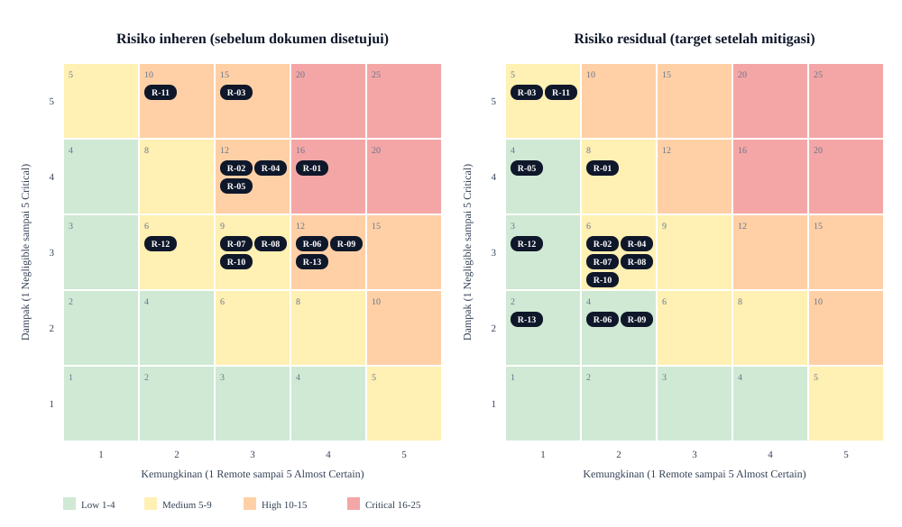

# Penilaian Risiko Hukum Program Kemitraan SLF/PBG

## Legal Risk Assessment

**Date**: 2026-10-25
**Assessor**: Claude (asisten AI), draf untuk ditinjau pemilik program dan konsultan hukum
**Matter**: Risiko hukum dari pelaksanaan empat skema kemitraan (Referral, Mitra Kolaboratif, Perwakilan Daerah, Cabang Resmi) PT Zof Engineering Indonesia sebelum dokumen pada matriks induk tersedia
**Privileged**: Tidak (bukan komunikasi dengan advokat)

> Ini bukan nasihat hukum. Metode: kerangka severity x likelihood dari skill `legal-risk-assessment`. Skala dampak pada kerangka tersebut berbasis persentase nilai kontrak; karena nilai transaksi belum diketahui, dampak dinilai kualitatif (keselamatan, kewenangan, regulasi, reputasi, operasional). Peringkat harus dikalibrasi ulang oleh pemilik program sesuai selera risiko perusahaan.

### 1. Risk Description

Program kemitraan sudah dipromosikan secara publik, tetapi 50 dokumen pengaturnya belum disusun. Tanpa dokumen, batas kewenangan, imbalan, data, merek, dan kompetensi teknis hanya bergantung pada kebiasaan dan niat baik para pihak.

### 2. Background and Context

- Empat skema dengan tingkat tanggung jawab berbeda; Cabang Resmi paling berat dan belum dibuka secara operasional.
- Layanan SLF/PBG menyangkut keselamatan bangunan, dokumen teknis, dan interaksi dengan instansi.
- Intake prospek saat ini lewat WhatsApp; penyimpanan, akses, dan pembagian data ke mitra belum diatur.
- Roadmap membuka strategi multi-situs dan profil pendukung.

### 3. Risk Analysis

Ringkasan peringkat (inheren = tanpa dokumen; residual = target setelah dokumen yang disebut disetujui dan dijalankan):

| ID | Risiko | Kategori | Inheren (S x L) | Level | Residual (S x L) | Level | Dokumen penahan (ID matriks) |
|---|---|---|---|---|---|---|---|
| R-01 | Mitra menjanjikan SLF/PBG pasti terbit, durasi, atau harga (klaim menyesatkan) | Regulatory / Konsumen | 4 x 4 = 16 | RED | 4 x 2 = 8 | YELLOW | UM-07, RF-05, UM-03, UM-08, WD-05 |
| R-02 | Mitra bertindak melampaui kewenangan dan mengikat perusahaan | Contract | 4 x 3 = 12 | ORANGE | 3 x 2 = 6 | YELLOW | WD-02, WD-05, UM-12, CB-07 |
| R-03 | Pekerjaan atau tanda tangan teknis oleh pihak tanpa kompetensi dan kewenangan | Regulatory / Profesi | 5 x 3 = 15 | ORANGE | 5 x 1 = 5 | YELLOW | KL-05, KL-06, UM-03, UM-05 |
| R-04 | Pemrosesan data pribadi prospek dan klien tanpa dasar, kebijakan, atau pembatasan | Data Privacy | 4 x 3 = 12 | ORANGE | 3 x 2 = 6 | YELLOW | UM-04, UM-09, RF-02, CB-08 |
| R-05 | Cabang Resmi dengan hak merek dan imbalan dapat memicu rezim waralaba, perizinan, dan pajak cabang | Regulatory / Corporate | 4 x 3 = 12 | ORANGE | 4 x 1 = 4 | GREEN | CB-01, CB-02, CB-03 |
| R-06 | Sengketa komisi, atribusi lead ganda, dan perlakuan pajak atas imbalan | Contract / Pajak | 3 x 4 = 12 | ORANGE | 2 x 2 = 4 | GREEN | UM-11, RF-03, RF-04, WD-06 |
| R-07 | Penyalahgunaan nama, logo, atau pengakuan status cabang oleh mitra | IP / Reputasi | 3 x 3 = 9 | YELLOW | 3 x 2 = 6 | YELLOW | UM-08, UM-07 |
| R-08 | Kebocoran informasi bisnis, harga, dokumen teknis, dan data klien | Contract / IP | 3 x 3 = 9 | YELLOW | 3 x 2 = 6 | YELLOW | UM-10, UM-09 |
| R-09 | Janji publik di halaman situs melampaui kesiapan operasional dan dokumen | Regulatory / Reputasi | 3 x 4 = 12 | ORANGE | 2 x 2 = 4 | GREEN | Koreksi halaman; gerbang kesiapan rancangan 16.10 |
| R-10 | Portofolio situs sister company dan profil sekoci menyesatkan atau melanggar kebijakan platform | Reputasi / Platform | 3 x 3 = 9 | YELLOW | 3 x 2 = 6 | YELLOW | UM-08, UM-01 |
| R-11 | Mitra menawarkan jalur cepat atau memberi imbalan kepada pihak instansi | Regulatory / Antikorupsi | 5 x 2 = 10 | ORANGE | 5 x 1 = 5 | YELLOW | UM-07, UM-11, UM-12 |
| R-12 | Hubungan hukum mitra salah dikualifikasikan (keagenan, kemitraan, atau hubungan kerja) | Contract / Employment | 3 x 2 = 6 | YELLOW | 3 x 1 = 3 | GREEN | UM-12, WD-01, KL-01 |

Distribusi inheren: 1 RED, 7 ORANGE, 4 YELLOW. Distribusi residual target: 0 RED, 0 ORANGE, 8 YELLOW, 4 GREEN.

#### Dasar penilaian per risiko

- **R-01 (Dampak 4, Kemungkinan 4)**: klaim berlebihan adalah perilaku yang lazim pada pemasaran berbasis komisi; dampaknya merugikan klien dan reputasi serta berpotensi menarik perhatian regulator. Kemungkinan tinggi karena insentif komisi, tidak ada pedoman, dan tidak ada sanksi tertulis.
- **R-02 (4, 3)**: pihak ketiga dapat mengira mitra berwenang bila tidak ada surat penunjukan dan batas otorisasi. Dampak pada kewajiban kontrak dan reputasi.
- **R-03 (5, 3)**: pekerjaan teknis tanpa kompetensi atau kewenangan berdampak pada keselamatan bangunan, keabsahan dokumen, dan tanggung jawab perusahaan. Kemungkinan sedang karena skema kolaboratif dan cabang melibatkan pelaksana pihak lain. Ketentuan kompetensi yang berlaku perlu diverifikasi konsultan hukum atau teknis.
- **R-04 (4, 3)**: UU No. 27 Tahun 2022 (diundangkan 17 Oktober 2022) mengatur pemrosesan data pribadi. Kemungkinan sedang karena data sudah dikumpulkan lewat WhatsApp tanpa kebijakan tertulis. Status peraturan pelaksana dan rencana perubahan undang-undang perlu dicek saat finalisasi.
- **R-05 (4, 3)**: bila cabang menerima hak merek dan sistem bisnis dengan imbalan, perlu dinilai apakah masuk waralaba (PP 42/2007, Permendag 71/2019, PP 35/2024; STPW) serta kewajiban perizinan dan pajak cabang. Kemungkinan sedang karena skema sudah dipublikasikan, tetapi belum dijalankan. Menunda penandatanganan sampai CB-01 selesai menurunkan kemungkinan menjadi remote.
- **R-06 (3, 4)**: tanpa dasar perhitungan dan atribusi tertulis, sengketa hampir pasti muncul begitu ada lebih dari satu sumber lead. Perlakuan pajak atas imbalan belum ditinjau.
- **R-07 (3, 3)**: mitra semangat mempromosikan cenderung memakai istilah "cabang" atau "resmi". Merek yang belum dipastikan terdaftar sulit ditegakkan.
- **R-08 (3, 3)**: dokumen teknis, harga, dan data klien akan berpindah tangan pada skema kolaboratif dan perwakilan.
- **R-09 (3, 4)**: terbukti ada: halaman publik menyebut dukungan yang dokumennya belum ada dan perkiraan waktu seleksi tanpa dasar keputusan internal. Mudah diperbaiki.
- **R-10 (3, 3)**: strategi portofolio situs bergantung pada transparansi afiliasi dan kebijakan platform pencari; kebijakan terbaru belum diverifikasi dalam penilaian ini.
- **R-11 (5, 2)**: dampak sangat berat bila ada pihak mengaku punya akses ke instansi atau memberi imbalan kepada pejabat; kemungkinan tidak besar tetapi insentif kecepatan nyata. Perlu larangan tegas dan sanksi.
- **R-12 (3, 2)**: kemitraan yang diatur ketat bisa terlihat seperti hubungan kerja atau agen; perlu perumusan perjanjian yang tepat.

### 4. Contributing Factors

- Insentif komisi dan tekanan memperluas jaringan cepat.
- Layanan SLF/PBG terlihat teknis tetapi sering dipasarkan oleh non-teknisi.
- Tidak ada penanggung jawab program dan pejabat penyetuju yang ditetapkan.
- Roadmap mendorong ekspansi kanal dan entitas.

### 5. Mitigating Factors

- Halaman publik sudah memuat batasan dan disclaimer yang konsisten dengan rancangan.
- Matriks induk menandai kebutuhan tinjauan hukum dan melarang status "Siap digunakan" tanpa persetujuan.
- Belum ada mitra aktif, sehingga eksposur nyata masih kecil.
- Cabang Resmi baru P3.

### 6. Mitigation Options

| Opsi | Efektivitas | Biaya/upaya | Direkomendasikan? |
|---|---|---|---|
| Selesaikan 11 dokumen P0 sebelum onboarding mitra apa pun | Tinggi | Sedang | Ya |
| Tunda menerima mitra Perwakilan Daerah dan Cabang Resmi sampai paket skema siap | Tinggi | Rendah | Ya |
| Koreksi tiga klaim di halaman publik | Sedang | Rendah | Ya |
| Tinjauan konsultan hukum untuk R-03, R-04, R-05, R-11 | Tinggi | Sedang sampai tinggi | Ya |
| Jalankan semua skema serentak dengan dokumen minimal | Rendah | Rendah | Tidak |
| Hapus skema Cabang Resmi dari situs | Sedang | Rendah | Pertimbangkan bila CB-01 belum dijadwalkan |

### 7. Recommended Approach

Urut menurut matriks: inventarisasi, P0, lalu paket Referral. Terima hanya mitra Referral (risiko paling kecil) setelah UM-07, UM-09, UM-11, RF-01 sampai RF-05 disetujui. Jangan menandatangani perjanjian Perwakilan Daerah atau Cabang Resmi sebelum paket skema dan CB-01 selesai.

### 8. Residual Risk

Bila rekomendasi dijalankan dan dipatuhi: tidak ada RED atau ORANGE; delapan YELLOW dan empat GREEN (lihat tabel). Risiko R-03 dan R-11 tetap bernilai dampak 5; hanya kemungkinannya yang ditekan, sehingga tetap dipantau.

### 9. Monitoring Plan

- Tinjau register risiko bulanan selama fase P0 dan P1, lalu per kuartal.
- Pemicu penilaian ulang: mitra pertama ditandatangani, keluhan klien tentang klaim mitra, peristiwa kebocoran data, perubahan peraturan (UU PDP, waralaba, bangunan gedung), keputusan membuka Cabang Resmi, peluncuran situs sister company.

### 10. Next Steps

1. Tetapkan penanggung jawab program dan pejabat penyetuju. Pemilik: pimpinan. Tenggat: [ditetapkan pemilik].
2. Selesaikan dokumen P0. Pemilik: pemilik program. Tenggat: [ditetapkan pemilik].
3. Koreksi halaman publik (R-09). Pemilik: pemilik program. Tenggat: sebelum promosi berikutnya.
4. Engage konsultan hukum untuk R-03, R-04, R-05, R-11 (kategori "strongly recommended": keahlian khusus dan kompleksitas yurisdiksi). Pemilik: pimpinan.
5. Verifikasi kebijakan platform pencari terbaru sebelum pilot sister company (R-10).

## Register Risiko

| Field | Catatan |
|---|---|
| Risk ID | R-01 sampai R-12 pada tabel di atas |
| Date Identified | 2026-10-25 untuk seluruhnya |
| Owner | Belum ditetapkan |
| Status | Open untuk seluruhnya |
| Review Date | [ditetapkan pemilik]; usulan: 2026-11-25 |
| Mitigations (saat ini) | Disclaimer halaman publik; matriks induk dengan gerbang persetujuan |
| Sumber | Rancangan halaman, roadmap, catatan persiapan, matriks induk, dan verifikasi rujukan hukum (UU 27/2022; PP 42/2007; Permendag 71/2019; PP 35/2024) |
