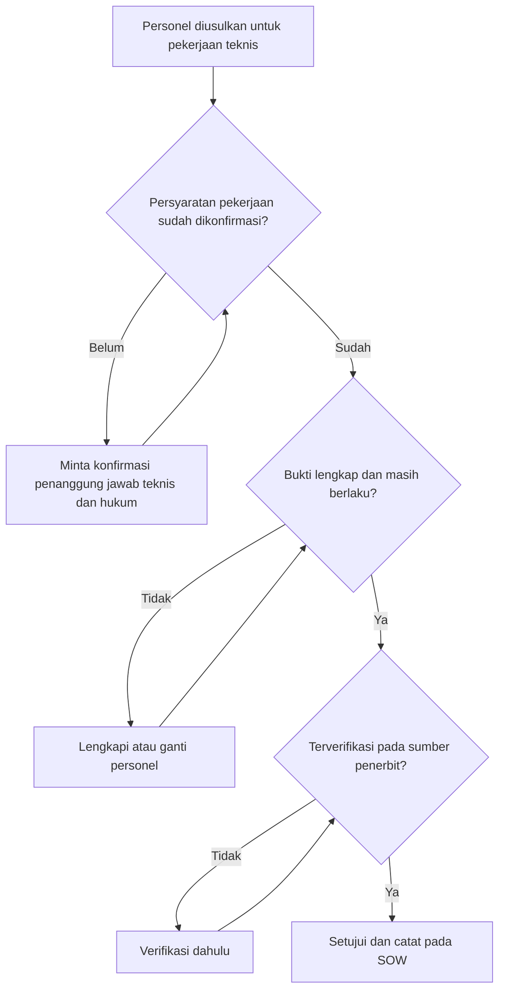

# KL-05 Checklist Kompetensi dan Kewenangan Personel dan Pihak Pelaksana

| Atribut | Isi |
|---|---|
| ID matriks | KL-05 (KOL, P1) |
| Versi | 0.1 (draf) |
| Tanggal draf | 2026-10-26 |
| Pemilik | Belum ditetapkan (usulan: penanggung jawab teknis) |
| Status | Perlu tinjauan hukum |

> Draf kerja. Dokumen ini **tidak** menyebut sertifikasi, kualifikasi, atau regulasi tertentu karena persyaratan untuk setiap jenis pekerjaan harus dikonfirmasi penanggung jawab teknis dan konsultan hukum terhadap ketentuan yang berlaku saat ini (risiko R-03). Kolom "Persyaratan" diisi setelah konfirmasi tersebut.

## 1. Prinsip

1. Tidak ada pekerjaan atau tanda tangan teknis sebelum checklist personel yang bersangkutan **lengkap dan terverifikasi**.
2. Status kemitraan tidak menggantikan kompetensi dan kewenangan.
3. Persyaratan mengikuti jenis pekerjaan dan ketentuan yang berlaku; bukan daftar tetap di dokumen ini.
4. Bukti harus asli atau dapat diverifikasi pada sumber penerbit, dan masa berlakunya dicatat.

## 2. Peta pekerjaan dan persyaratan

| Pekerjaan teknis | Persyaratan yang berlaku | Dikonfirmasi oleh | Tanggal konfirmasi |
|---|---|---|---|
| Survei lapangan | [DIISI setelah konfirmasi] | [penanggung jawab teknis] | |
| Kajian teknis bangunan | [DIISI] | | |
| Penyusunan dokumen teknis | [DIISI] | | |
| Penandatanganan dokumen teknis | [DIISI] | | |
| Pekerjaan non-teknis (administrasi, koordinasi) | Tidak memerlukan kualifikasi teknis; tetap tunduk UM-07 | | |

## 3. Checklist per personel

| Item | Isi |
|---|---|
| Nama dan peran dalam proyek | |
| Pihak yang mempekerjakan atau menugaskan | Perusahaan / Mitra / Pihak lain |
| Pekerjaan yang akan dilakukan | Dari peta bagian 2 |
| Bukti kompetensi dan kewenangan (jenis, nomor, penerbit) | |
| Masa berlaku | |
| Diverifikasi pada sumber penerbit | Ya / Tidak, tanggal, oleh |
| Konflik kepentingan diungkapkan | Ya / Tidak |
| Pengalaman relevan (referensi) | |
| Status | Memenuhi / Perlu klarifikasi / Tidak memenuhi |
| Persetujuan penanggung jawab teknis | Nama, tanggal |

## 4. Alur keputusan

## 5. Pemantauan

- Daftar personel kunci dan masa berlaku bukti disimpan pada UM-14 atau daftar terpisah milik penanggung jawab teknis: [DIISI PEMILIK].
- Tinjau [KEPUTUSAN: periode] dan sebelum setiap proyek baru.
- Bukti yang kedaluwarsa menghentikan penugasan personel pada pekerjaan teknis sampai diperbarui.
- Pergantian personel mengikuti PKS (KL-01 pasal 9).

## 6. Tanda bahaya

Bukti tidak dapat diverifikasi, nama pada dokumen berbeda tanpa penjelasan, personel menolak menyerahkan bukti, satu orang disebut mengerjakan terlalu banyak proyek bersamaan tanpa kapasitas, atau meminta "tanda tangan dipinjamkan".
