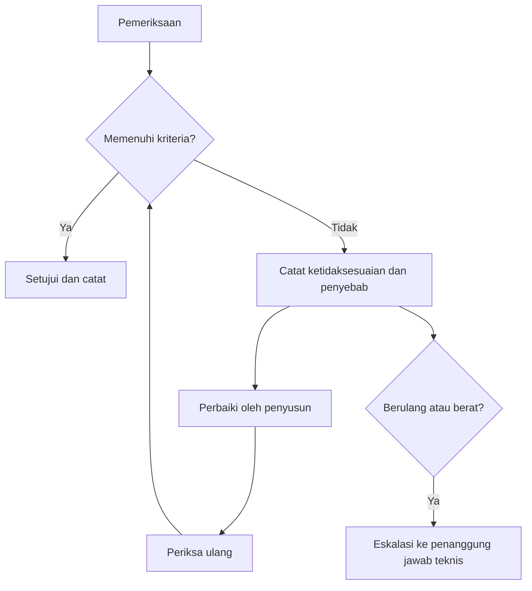

# KL-06 SOP Pengendalian Mutu dan Pemeriksaan Deliverable

| Atribut | Isi |
|---|---|
| ID matriks | KL-06 (KOL, P1) |
| Versi | 0.1 (draf) |
| Tanggal draf | 2026-10-26 |
| Pemilik | Belum ditetapkan (usulan: penanggung jawab teknis dan mutu) |
| Status | Perlu persetujuan internal |

> Draf kerja. Pemeriksaan teknis dilakukan oleh personel yang memenuhi syarat (KL-05). Kriteria isi tiap deliverable ditetapkan penanggung jawab teknis per jenis layanan; dokumen ini menyediakan kerangka proses.

## 1. Tujuan dan cakupan

Memastikan setiap deliverable proyek kolaboratif diperiksa sebelum diserahkan kepada klien atau diajukan ke instansi, terlepas dari siapa yang menyusunnya.

## 2. Prinsip

1. **Pembuat bukan pemeriksa**: deliverable diperiksa orang lain.
2. **Pemeriksa teknis memenuhi syarat** (KL-05).
3. **Tidak ada penyerahan tanpa catatan pemeriksaan.**
4. **Pihak yang memeriksa berhak menolak** deliverable yang tidak memenuhi kriteria.

## 3. Titik pemeriksaan

| Titik | Waktu | Yang diperiksa | Pemeriksa |
|---|---|---|---|
| P1 Kickoff | Sebelum pekerjaan | SOW, personel terverifikasi, data awal | Pemilik proyek |
| P2 Kelengkapan data | Setelah data diterima | Dokumen lengkap, konsisten, terbaru | Penyusun dan pemeriksa |
| P3 Draf | Sebelum kajian final | Metode, asumsi, sumber data | Tenaga ahli |
| P4 Final internal | Sebelum diserahkan atau diajukan | Seluruh kriteria penerimaan SOW | Pemeriksa independen |
| P5 Setelah umpan balik | Setelah catatan klien atau instansi | Perbaikan menjawab catatan | Pemeriksa yang sama jika memungkinkan |

## 4. Checklist deliverable (kerangka)

| Pemeriksaan | Ya | Tidak | Catatan |
|---|---|---|---|
| Sesuai SOW dan kriteria penerimaan | | | |
| Identitas bangunan dan pemilik benar di seluruh dokumen | | | |
| Angka, referensi, dan lampiran konsisten | | | |
| Sumber data dicantumkan dan dapat ditelusuri | | | |
| Kesimpulan teknis ditandatangani pihak yang memenuhi syarat | | | |
| Tidak ada klaim hasil atau keputusan instansi | | | |
| Versi dan tanggal jelas | | | |
| Data pribadi dibatasi sesuai UM-09 | | | |

Daftar rinci per jenis layanan (SLF, PBG, pengkajian, as-built) ditambahkan oleh penanggung jawab teknis: [DIISI].

## 5. Ketidaksesuaian

Ketidaksesuaian berat (kesimpulan tidak berdasar, tanda tangan di luar kewenangan, data keliru material) menghentikan penyerahan dan ditangani sesuai UM-07.

## 6. Pencatatan

- Catatan pemeriksaan: tanggal, titik, pemeriksa, hasil, tindakan.
- Disimpan bersama berkas proyek sesuai UM-09; versi disusun berurutan.
- Rekap bulanan jumlah ketidaksesuaian per mitra dan penyebab; hasil dipakai pada evaluasi mitra.

## 7. Wewenang menghentikan pekerjaan

Pemilik proyek atau penanggung jawab teknis dapat menghentikan penyerahan bila mutu atau kepatuhan tidak terpenuhi. Pihak lain tidak boleh mengabaikan penghentian itu.

## 8. Indikator

Persentase deliverable lolos pada pemeriksaan pertama, jumlah putaran perbaikan, keterlambatan akibat mutu, dan keluhan klien. Target ditetapkan setelah data awal tersedia: [KEPUTUSAN].
