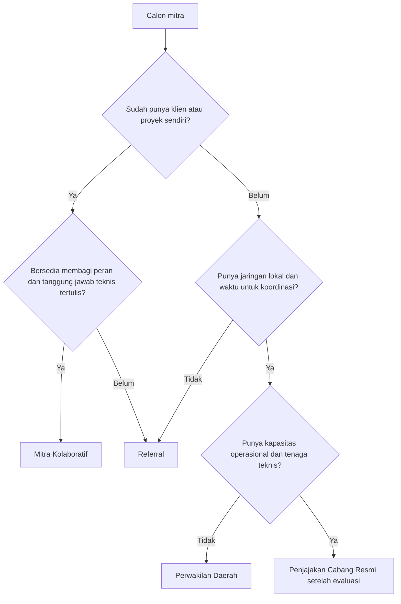

# UM-03 Panduan Perbandingan Empat Skema Kemitraan

| Atribut | Isi |
|---|---|
| ID matriks | UM-03 (UMUM, P0) |
| Versi | 0.1 (draf) |
| Tanggal draf | 2026-10-25 |
| Pemilik | Belum ditetapkan (usulan: pemilik program) |
| Status | Perlu persetujuan internal |

> Draf kerja. Selaras dengan isi halaman publik `/kemitraan/`. Bila ada perbedaan, dokumen ini diperbarui dan halaman publik dikoreksi, bukan sebaliknya diam-diam.

## 1. Perbandingan

| Aspek | Referral | Mitra Kolaboratif | Perwakilan Daerah | Cabang Resmi |
|---|---|---|---|---|
| Peran utama | Memperkenalkan calon klien | Mendukung proyek sesuai kesepakatan | Mengembangkan pasar dan koordinasi lokal | Menjalankan operasi wilayah sesuai tata kelola |
| Pengelolaan klien | Perusahaan menindaklanjuti | Disepakati per proyek | Terkoordinasi dengan perusahaan | Mengikuti SOP dan pembagian kewenangan |
| Pekerjaan teknis | Bukan peran mitra | Sesuai kompetensi masing-masing pihak | Bukan peran perwakilan; dieskalasi | Hanya melalui tenaga dan kewenangan yang memenuhi syarat |
| Penggunaan merek | Tidak otomatis | Terbatas, izin tertulis | Persetujuan tertulis | Perjanjian dan otorisasi |
| Eksklusivitas | Umumnya tidak diperlukan | Per kasus | Dapat dipertimbangkan, tidak otomatis | Dapat dipertimbangkan berdasarkan evaluasi |
| Administrasi | Minimal | Sesuai proyek | Pelaporan terstruktur | Tata kelola paling lengkap |
| Kualifikasi minimum | Etika dan identitas jelas | Kompetensi relevan untuk bagian yang dikerjakan | Jaringan lokal dan kepatuhan pedoman | Kapasitas operasional, tenaga teknis, tata kelola |
| Verifikasi | Identitas dan kontak | Identitas, kompetensi, referensi | Identitas, jaringan, reputasi | Penuh, termasuk legal dan keuangan yang relevan |
| Perjanjian | Perjanjian referral | Perjanjian kerja sama atau per proyek | Surat penunjukan dan perjanjian | Perjanjian cabang |
| Kesiapan operasional | Paling siap diuji | Setelah pembagian tanggung jawab jelas | Setelah seleksi, wilayah, dan pedoman siap | Setelah tata kelola terbukti |

## 2. Yang berlaku untuk semua skema

- Tidak ada jaminan SLF/PBG terbit atau selesai dalam durasi tertentu.
- Tidak ada jaminan penghasilan atau jumlah klien.
- Tidak boleh memberi kesimpulan teknis tanpa kompetensi dan data yang sesuai.
- Tidak boleh menawarkan jalur cepat atau memberi imbalan kepada pihak instansi.
- Imbalan, wilayah, dan eksklusivitas hanya berlaku bila tertulis.
- Naik atau pindah skema memerlukan peninjauan dan kesepakatan baru.

## 3. Memilih skema

Diagram hanya panduan awal. Penetapan skema dilakukan lewat seleksi (UM-05).

## 4. Dokumen per skema

| Skema | Dokumen utama pada matriks |
|---|---|
| Referral | RF-01 sampai RF-06 |
| Mitra Kolaboratif | KL-01 sampai KL-08 |
| Perwakilan Daerah | WD-01 sampai WD-07 |
| Cabang Resmi | CB-01 sampai CB-09 |

## 5. Pertanyaan yang sering muncul dan jawaban baku

| Pertanyaan | Jawaban baku |
|---|---|
| Apakah harus berbadan usaha? | Tidak otomatis wajib untuk semua skema; ditinjau sesuai skema. Untuk Cabang Resmi, kajian hukum (CB-01) menentukan. |
| Apakah dapat wilayah eksklusif? | Tidak otomatis; hanya jika disepakati tertulis. |
| Apakah boleh memakai nama perusahaan? | Hanya dengan persetujuan tertulis dan sesuai UM-08. |
| Berapa lama prosesnya? | Dibahas setelah peninjauan awal; tidak ada janji durasi. |
| Berapa imbalannya? | Disepakati tertulis; tidak dipublikasikan dan tidak dijanjikan. |
