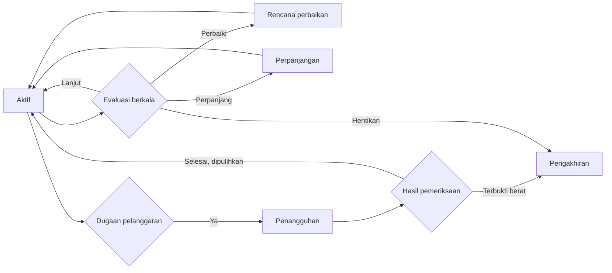

# UM-13 Templat Evaluasi, Perpanjangan, Penangguhan, dan Pengakhiran Kemitraan

| Atribut | Isi |
|---|---|
| ID matriks | UM-13 (UMUM, P1) |
| Versi | 0.1 (draf) |
| Tanggal draf | 2026-10-26 |
| Pemilik | Belum ditetapkan (usulan: pemilik program dan operasional) |
| Status | Perlu tinjauan hukum |

> Draf kerja. Hak menangguhkan dan mengakhiri berdampak pada hak kontraktual, sehingga prosedur, tenggat, dan akibatnya wajib ditinjau hukum. Angka bertanda [KEPUTUSAN]. Evaluasi berkala yang lebih rinci ada pada OP-05 (P2).

## 1. Siklus kemitraan

## 2. Evaluasi

| Hal | Ketentuan |
|---|---|
| Frekuensi | [KEPUTUSAN: mis. per kuartal untuk 12 bulan pertama] |
| Penilai | Pemilik program, dengan masukan pihak teknis dan keuangan |
| Bahan | Laporan aktivitas, bukti penerimaan lead, catatan mutu (KL-06), keluhan, kepatuhan UM-07 |
| Hasil | **Lanjut**, **Perbaiki** (dengan rencana dan tenggat), **Perpanjang**, **Ubah skema**, atau **Hentikan** |
| Hak mitra | Menerima ringkasan penilaian dan menanggapi sebelum keputusan |

## 3. Perpanjangan

- Diajukan atau dibahas [KEPUTUSAN: hari] sebelum berakhir.
- Dasar: hasil evaluasi, kepatuhan, dan kebutuhan Perusahaan; perpanjangan tidak otomatis.
- Dibuat perubahan atau addendum bernomor; dicatat pada OP-03 dan UM-14.

## 4. Perubahan skema

Naik atau turun skema tidak otomatis. Perlu seleksi ulang (UM-05) dan perjanjian skema baru. Hak, wilayah, dan kewenangan skema lama berhenti pada tanggal berlaku skema baru.

## 5. Penangguhan

| Hal | Ketentuan |
|---|---|
| Pemicu | Dugaan pelanggaran sedang atau berat (UM-07), klaim yang menyesatkan, penggunaan merek di luar izin, kebocoran data, bukti kompetensi kedaluwarsa (KL-05), atau tidak aktif lama |
| Wewenang | Pemilik program, dengan pemberitahuan kepada direksi [KEPUTUSAN] |
| Akibat | Penghentian sementara aktivitas yang relevan, materi diturunkan, prospek baru ditahan; kewajiban kerahasiaan tetap |
| Hak mitra | Diberi tahu alasan dan diberi kesempatan menanggapi dalam [KEPUTUSAN] hari kerja |
| Durasi | Paling lama [KEPUTUSAN], lalu dipulihkan atau diakhiri |
| Imbalan | Mengikuti perjanjian; komisi yang disengketakan ditahan sampai keputusan [tinjau hukum] |

## 6. Pengakhiran

| Dasar | Catatan |
|---|---|
| Berakhirnya masa berlaku tanpa perpanjangan | Otomatis; pemberitahuan penutupan |
| Kesepakatan para pihak | Tertulis |
| Pelanggaran berat (suap, jalur cepat, tanda tangan tanpa kewenangan, kebocoran data berat, penipuan) | Seketika; dapat melapor kepada pihak berwenang |
| Pelanggaran yang tidak diperbaiki dalam tenggat | Sesuai perjanjian |
| Kepentingan Perusahaan atau perubahan program | Dengan pemberitahuan wajar [KEPUTUSAN, tinjau hukum] |

## 7. Daftar penutupan (transisi)

| Hal | Tindakan |
|---|---|
| Materi, logo, sebutan, akun | Dihentikan dan diturunkan dalam [KEPUTUSAN] hari |
| Data prospek dan klien | Diserahkan atau dihapus sesuai UM-09 |
| Prospek berjalan | Diteruskan ke pusat; atribusi sesuai RF-03 |
| Imbalan terutang | Dihitung dan dibayar sesuai UM-11; sengketa mengikuti perjanjian |
| Dokumen dan akses | Akses dicabut; dokumen dikembalikan |
| Kerahasiaan dan larangan | Berlanjut sesuai UM-10 dan perjanjian |
| Catatan | Register OP-03 dan UM-14 diperbarui |

## 8. Format surat (isi minimal)

- **Surat hasil evaluasi**: nomor, tanggal, mitra, periode, ringkasan temuan, hasil, tindak lanjut dan tenggat.
- **Surat penangguhan**: dasar, pasal yang dilanggar, akibat, batas waktu menanggapi, kontak.
- **Surat pengakhiran**: dasar dan pasal, tanggal efektif, daftar penutupan, kewajiban yang berlanjut, kontak.

Setiap surat ditandatangani pejabat berwenang dan dicatat.
